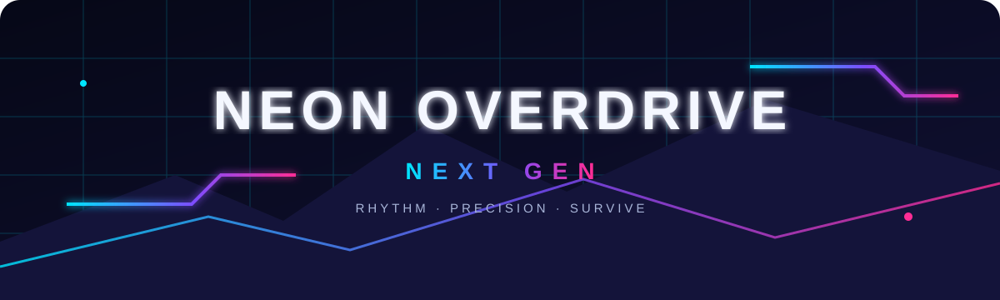

# NEON OVERDRIVE — NEXT GEN

<p align="center"></p>
<p align="center"><strong>A neon rhythm-platformer built for the browser.</strong><br>Precision movement · Reactive worlds · Boss encounters</p>
<p align="center">


</p>

---

## Overview

NEON OVERDRIVE — NEXT GEN is a fast-paced neon platform game featuring zone progression, unlockable content, touch and keyboard controls, local progress, and a final-zone boss.

## Features

- 10 progression zones
- 12 character skins
- Canvas 2D rendering
- Keyboard and mobile touch input
- Local save data
- Collectibles, hazards and checkpoints
- Boss encounter in the final zone
- Standalone HTML release build

## Play

- **Myket:** [Open the game](https://myket.ir/app/com.webapp.neonoverdriv.q6cc)
- **Source:** [GitHub repository](https://github.com/TahaDev24/NEON-OVERDRIVE)

## Structure

```
NEON-OVERDRIVE/
├── assets/
│   ├── banner.svg
│   └── css/game.css
├── src/js/
│   ├── core/
│   │   ├── config.js
│   │   ├── input.js
│   │   └── save.js
│   ├── render/renderer.js
│   ├── world/level.js
│   └── main.js
├── docs/
├── tools/
├── release/
├── index.html
└── package.json
```

## Run

Open `index.html` in a modern browser. For development, install Node.js and run:

```bash
npm install
npm run check
npm run build
```

The standalone build is written to `release/NEON_OVERDRIVE_NEXT_GEN.html`.

## Controls

| Action | Keyboard | Touch |
|---|---|---|
| Move | Arrow keys / A-D | Direction controls |
| Jump | Space / W / Up | Jump button |
| Pause | Escape / P | Pause control |

## Progression

Zone 01 is the starting zone. Clearing a zone unlocks the next zone in sequence. Progress is stored locally in the browser.

## Credits

Created by **Taha Hesaraki** · [GitHub](https://github.com/TahaDev24)
